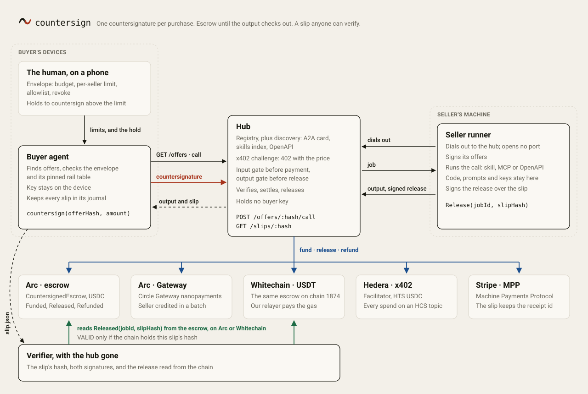

<p></p>

countersign lets a software agent pay for a call to another piece of software with one signature that binds the offer, the payee and the amount, and hands it back a receipt that proves itself without the hub.

What is built, what is on a branch and what is only designed: [docs/status.md](docs/status.md).

## Get started

Testnet only. Install from npm: `npx -y @countersign-hub/cli --help` and `npm i @countersign-hub/relay`, on Node 20 or later. Only the `@countersign-hub` scope is this project's: `countersign`, `countersign-mcp` and `@countersign` on npm belong to other projects. The commands are in [docs/onboarding.md](docs/onboarding.md).

- **Hire a tool from your agent.** The MCP server for Claude and Cursor (`npx -y @countersign-hub/cli mcp`), or `countersign buy`, pays in test USDC on Arc.
- **List your tool.** `countersign sell skill` or `countersign sell openapi` sells a skill or an operation of an API. The runner dials out, so you open no port.
- **Charge for your API in USDT.** One middleware on a route, on Whitechain testnet, with a relay of your own paying the gas.

## Rails

One interface, one slip shape. Nothing above a rail knows which chain it is on ([docs/spec/rail.md](docs/spec/rail.md)).

**Live** means the production hub declares the rail on [`/rails`](https://hub-production-e85e.up.railway.app/rails): `escrow` (Arc), `whitechain` and `hedera-scheduled`, three in all. **Listed** means a rail that appears in discovery or in sellers' offers but is not live: `gateway` and `hedera` today, which older offers still name.

| Rail | Network | Token | Kind | Status |
|---|---|---|---|---|
| Arc | Arc testnet, chain `5042002` | USDC `0x3600000000000000000000000000000000000000` | escrow | Live. [Paid release](https://explorer.testnet.arc.io/tx/0x02b65aabec26062e828e1b91203a9d8de5cdab0a6717bbf087054c76b3702809), more in [docs/proof.md](docs/proof.md). |
| Whitechain | Whitechain Sepolia, chain `1874` | USDT `0xcedfB56113143d55b2358b8CFbB0dEB5Ad2f55a7` | escrow, relayer pays gas | Live on the production hub: a paid call's [fund](https://explorer.testnet.whitechain.io/tx/0x1d45e70ff0ac33d9fee2b503f7acb22370a107232a98eb3d7afa7b7d4d321e73) and [release](https://explorer.testnet.whitechain.io/tx/0xd60dd634a1b326947ef855eee129cf7f994f0c6fdd5b58843f3d5310fdcc5971), the buyer holding no WBT; a [merchant refund](https://explorer.testnet.whitechain.io/tx/0x565830d7a63f64b7ab3c910b2063345f3d75695d6405d4ffb5495d53e79388e5). The hub loads it with `WC_RELAY_URL`, and the relay submits and pays the gas ([docs/whitechain.md](docs/whitechain.md)). |
| Hedera | Hedera testnet, `hedera:testnet` | HTS USDC `0.0.429274` | held (`hedera-scheduled`) on the production hub; direct x402 v2 `exact` through a hosted facilitator in a hub that turns it on | Live, held. Earlier, over plain x402: an [agent-paid call through the hub](https://hashscan.io/testnet/transaction/0.0.9185802@1793962668.996163078). The production hub runs only the held rail (`hedera-scheduled`); plain x402 is off there because it pays before the seller runs. The held payment moves only when the seller countersigns and the hub co-signs after checking the delivery; neither can release it alone (a held payment the seller signed but the hub did not expired unexecuted: [`0.0.11343208`](https://testnet.mirrornode.hedera.com/api/v1/schedules/0.0.11343208)). A held purchase's transfer: [`0.0.11337064@1793978974.115868685`](https://testnet.mirrornode.hedera.com/api/v1/transactions/0.0.11337064-1793978974-115868685). See [Hedera payment flow](#hedera-payment-flow). |
| MPP | Tempo testnet (Moderato), chain `42431`, `mpp:tempo` | pathUSD `0x20c0000000000000000000000000000000000000` | direct, MPP's Tempo charge (402 with `WWW-Authenticate: Payment`, `Payment-Receipt` on success) | `IN PROGRESS`: not on the hub yet. A real payment through the rail on Tempo testnet, from its own demo endpoint: [0.01 pathUSD settled](https://explore.testnet.tempo.xyz/tx/0x4866e130e21972d08eb7c52eab353bb6259b0f9866621979682cef2179e3a89f). Stripe's card method sits behind `MPP_STRIPE=1`. See [docs/mpp.md](docs/mpp.md). |

A Circle Gateway rail (batched nanopayments on Arc testnet) runs in a hub started with `GATEWAY_RAIL=1`. On production it is listed, not live: the production hub runs it off, because Gateway debits the buyer before the seller runs. Gateway debits the buyer at once and credits the seller in a later batch, so a nanopayment has a Gateway transfer id, not a per-call chain transaction. The first one, 0.01 USDC, is transfer `a69f94c8-8771-4d8b-96ba-fe189501f80c`, after a [1 USDC deposit](https://explorer.testnet.arc.io/tx/0x4ae047192cda083df967bfe371359dd4f4a7bfde7cde1f61ea9b2a9ddab91cbc) ([docs/proof.md](docs/proof.md)).

**On Whitechain** countersign is a merchant checkout, not an escrow product: see [Whitechain: a merchant checkout](#whitechain-a-merchant-checkout).

## Whitechain: a merchant checkout

A merchant sells to software buyers for USDT on Whitechain testnet (chain 1874). It sees every order as it settles, refunds an order, and exports the ledger as CSV for the accountant. The escrow contract and the gas relayer are the mechanism underneath, not the product. Network facts, the relayer and verification are in [docs/whitechain.md](docs/whitechain.md), and feedback for the Whitechain team in [WHITECHAIN_FEEDBACK.md](WHITECHAIN_FEEDBACK.md).

**Why this needs onchain stablecoin settlement on Whitechain.** The buyer is software, so the payment has to enforce itself:
- A USDT payment on Whitechain will not settle for a payee or an amount the buyer did not sign.
- On the hub's `whitechain` rail, it waits in escrow until the seller's delivery passes the hub's gate, and anyone can refund it once its deadline passes.
- Every payment and every refund leaves a public record that the customer can check without trusting us.

A card network cannot bind a payment to an offer hash, or release it on a signed delivery receipt. The relayer pays the gas, so neither the customer nor the merchant ever holds WBT.

### Operate: the checkout, the refund and the export

- **The drop-in.** It is two files:
  - [`examples/whitechain/checkout-merchant.ts`](examples/whitechain/checkout-merchant.ts) puts a route behind `whitechainPaywall`;
  - [`examples/whitechain/checkout-customer.ts`](examples/whitechain/checkout-customer.ts) pays it with `createPayFetch`.

  Both import the published package: `@countersign-hub/relay/paywall` and `@countersign-hub/relay/browser`. In your own app, run `npm i @countersign-hub/relay hono viem` and the two files work unchanged. Never install `@countersign/relay`: the `@countersign` scope on npm belongs to another project.

  Together they are 13 non-empty lines, and `apps/web/test/checkout.test.ts` fails if they pass twenty. They are not a separate app: the console's own server imports the merchant half to serve its checkout (`apps/web/server.ts`), live at [`/checkout/sticker-pack`](https://web-production-a58de.up.railway.app/checkout/sticker-pack), which answers 402 with an x402 `exact` request for 0.01 USDT on chain 1874. Both import `@countersign/relay`, a package in this repository that is not published yet.
- **It runs against the production relay.** `examples/whitechain/checkout.live.test.ts` bought and refunded for real: [purchase](https://explorer.testnet.whitechain.io/tx/0x59eb27e66c4a71bf48656e4c0bc00f717e89f43edb23f6abe9282fc7b939c12b) and [refund](https://explorer.testnet.whitechain.io/tx/0x3efd65a06cdf38a269a008ee12fdbeae2ceff2210f210bae887da327baa7bd6f), both submitted by the relayer.
- **The customer's view.** The customer holds USDT only and signs one EIP-3009 authorisation. The buyer above, `0xcb39cEfBF97d1FE8b0606f25721F6F9E32924298`, holds 0 WBT.
- **The refund.** One function, `refundOrder`, refunds every order:
  - a held escrow order is cancelled in full;
  - a paid order is refunded in full or in part, by a transfer the merchant signs and the relayer submits.

  Each refund signature names its payment and the amount already refunded, so a repeated click refunds once. A settled purchase whose buyer did not get the item was refunded in full: [purchase](https://explorer.testnet.whitechain.io/tx/0x087656364e52a112591a2e740d88c8faf69655f8c4187ef772d2041032c7ac82), [refund](https://explorer.testnet.whitechain.io/tx/0x2707a2d7e4f7a42b95f930bbcf41efa849a49c6ea12f4549361cd5829657e13e).
- **The merchant's view.** The merchant refunds from the order's row: it reads the terms, then signs once in its own wallet, and the relayer pays the gas. That screen is not on the production console yet.
- **The accountant's export.** The production relay serves [`orders.csv`](https://whitechain-relay-production.up.railway.app/orders.csv?merchant=0xd5882dBC7D41fBcf8ae0B05E9eAc1cbe93d6C71c). It has one row per order, with the amount, fee, refunded and net amounts, and links to each transaction. The e2e `merchant` flow checks the totals, a partial refund and the export against the chain.

### Scale: the payer holds zero WBT

The relayer `0xa2EEfc657138eE5367291F8e2Ac45BAC28486006` submits every transaction above and pays the gas, so customers and merchants hold USDT only. Its guards are live at [`/status`](https://whitechain-relay-production.up.railway.app/status):

| Guard | Value |
|---|---|
| Allowlist | USDT `0xcedfB56113143d55b2358b8CFbB0dEB5Ad2f55a7`, the merchant `0xd5882dBC7D41fBcf8ae0B05E9eAc1cbe93d6C71c` and the escrows, v1 `0x9279D3edeef4c3738a0b200D762e2985Ff3B7eb4` and v2 `0x55b3…0391`; it pays gas for nobody else |
| Fee cap | 50 gwei per gas, with 20% headroom |
| Hourly ceiling | 0.05 WBT and at most 200 transactions per hour |
| Balance floor | 0.02 WBT; below it the relay refuses new work, rather than running dry mid-payment |
| Minimum payment | 0.01 USDT |
| Simulation | every call is simulated before it is sent, so a refused call costs no gas (`packages/relay/src/relayer.ts`) |

**How the business funds it:** the operator sends WBT to the relayer address. It held 1.42 WBT on 06 Nov. The floor and the ceiling bound what one hour can spend.

## Live links

- Repository: https://github.com/ss251/countersign
- Console: [web-production-a58de.up.railway.app](https://web-production-a58de.up.railway.app)
- Hub: [hub-production-e85e.up.railway.app](https://hub-production-e85e.up.railway.app/healthz). A purchase through it [released on Arc](https://explorer.testnet.arc.io/tx/0x0a0118e9e81c21517eaf0f387e7801e1fafef947cfccd1c05ff989201433ed69), slip `0x3204ff870ffad20b38d9504622e5889508d889a10f3f1efef05d16046ab2fe85`.
- Arc Studio: the project's [share page](https://studio.arc.io/share/countersign-automated-software-marketplace-9tfb9kfte9) and the [app Studio built](https://arc-studio-16e0b317ec5f406a8d7d24bf.vercel.app), both open logged out. The Studio app reads the same escrow addresses as the rest of the project.
- Arc escrow, deployed through Arc Studio: [`0x19c27d770969291e6a0a305dc1be1a845e7c1b76`](https://explorer.testnet.arc.io/address/0x19c27d770969291e6a0a305dc1be1a845e7c1b76)
- Whitechain escrow: [`0x9279D3edeef4c3738a0b200D762e2985Ff3B7eb4`](https://explorer.testnet.whitechain.io/address/0x9279D3edeef4c3738a0b200D762e2985Ff3B7eb4)
- Hedera spend log: HCS topic [`0.0.11337070`](https://hashscan.io/testnet/topic/0.0.11337070)
- More proofs with explorer links: [docs/proof.md](docs/proof.md) for Arc and Gateway, [docs/whitechain.md](docs/whitechain.md) for Whitechain, [docs/hedera.md](docs/hedera.md) for Hedera.

## How it works

1. **The offer.** A seller publishes a signed offer: price, input and output schema, delivery deadline and the rails it accepts. `offerHash` is the keccak256 of its canonical JSON, so any change, the price included, is a new offer with a new hash ([offer.md](docs/spec/offer.md)).
2. **The envelope.** The human sets the agent's limits: a total budget cap, a per-merchant limit, an allowlist, an ask-above threshold, and revoke. The agent checks them, then reserves the spend in its journal, before it signs anything ([envelope.md](docs/spec/envelope.md)). A refusal reads, for example, "Refused. This would spend 5.000001 of a 5 budget."
3. **The countersignature.** The buyer signs one message. On escrow rails it is the token's EIP-3009 `ReceiveWithAuthorization`, whose nonce is the `jobId` derived from the offer hash, buyer, payee, amount, deadline and salt under the escrow's EIP-712 domain. Change any of them and the signature no longer matches ([countersignature.md](docs/spec/countersignature.md)).
4. **The escrow.** `CountersignedEscrow` pulls the amount on `fund`, pays the seller on `release` with the seller's signature over the slip hash, and returns the full amount to the buyer on `refund` after the deadline or on the seller's `cancel`. It has no owner, no pause and no proxy ([escrow.md](docs/spec/escrow.md)).

A moved price reverts on chain: [Arc, price moved](https://explorer.testnet.arc.io/tx/0xca61627848d1ea952c5953ac58df7b8bd780777563e24ebccf5bb90315d20e76). A missed deadline refunds the buyer in full: [fund](https://explorer.testnet.arc.io/tx/0x6a103973020747af341e008ec5b317cc97ac0ffef059c381fb19d9cdf9ca2eb7), [refund](https://explorer.testnet.arc.io/tx/0x1cd2a5a624a6c166d6b85e99dfaffcbd03c1c65c17fe7010109610872c499e35).

## The receipt

A released call leaves a slip: `{body, hash, sellerSig, payment, settlement}` ([slip.md](docs/spec/slip.md)). The body holds the rail, offer hash, job id, parties, amount, the hashes of the input and output, the delivery time and, on escrow rails, the escrow and chain.

A verified slip proves:

- **hash:** `hash` is the keccak256 of the canonical body, so it commits to every field.
- **seller:** the seller's EIP-712 `Release(jobId, slipHash)` signature recovers to the seller named in the body.
- **terms and countersignature:** the buyer's countersigned terms derive the body's `jobId`, and the buyer's signature recovers to the buyer.
- **on chain:** with an RPC URL, the escrow's `Released(jobId, slipHash)` event carries this slip's hash. The committed hash covers the body without the settlement receipt, because the release transaction cannot exist before the hash it commits ([decisions.md](docs/decisions.md), D9). A tampered body with a recomputed hash still fails, because the chain holds the original.

The verifier imports nothing from the hub. Without `--rpc` it proves who signed what and says the chain was not read.

## Who pays, and from which wallet

Where this is going: the person's wallet on EVM, the agent's account on Hedera, one envelope over both. Only the third class below is live today.

| Class of user | Wallet | Rails | Status |
|---|---|---|---|
| Wants an embedded wallet | Privy, signing in with email or a passkey | Arc; Whitechain | Live on Arc: a person signed in and bought on production, in [a production run](e2e/human/runs/20261106-192916-e0f5.md). Whitechain is not configured yet, `IN PROGRESS` |
| Holds their own Hedera wallet | HashPack, Blade or Kabila through WalletConnect | Hedera | `IN PROGRESS` until its proof lands. It will be a direct payment, so a failed delivery is not returned |
| Does not want a wallet | The agent's own Hedera account `0.0.11337064`, funded and bounded by the human's envelope; the human never holds a Hedera key | Hedera | Live on the production hub, held: the payment moves only when the seller countersigns and the hub co-signs after a checked delivery |

Privy has no Hedera, and none of these is one wallet for every rail.

Two things are true today and differ from the table's end state:
- The EVM rails are paid by the buyer agent's own wallet.
- The EVM buyer and the Hedera agent apply the same envelope rules but keep separate budgets. One shared budget is not built yet.

Each status, with its evidence: [docs/status.md](docs/status.md).

## Hedera payment flow

An agent pays on Hedera testnet over x402 v2, through a hosted facilitator, with no human in the loop. Traced through one real payment, from [docs/hedera.md](docs/hedera.md):

The agent `0.0.11337064` bought one call to Circle's `use-usdc` skill (Apache-2.0) for 0.05 USDC through the countersign hub, with no human approving. The seller's runner served the skill and was paid on Hedera at `0.0.11337065`. Every value below was read back from Hedera testnet.

1. **Discover.** The agent lists offers with `GET /offers` on the hub and picks the one that settles on the `hedera` rail: offer `0xfd440a4a…22fc`. The seller's runner published it with `--rails hedera --pay-to hedera=0.0.11337065`.
2. **Challenge.** The hub answers `402` with x402 v2 payment requirements:
   - `scheme: exact` and `network: hedera:testnet`;
   - `asset: 0.0.429274` (USDC) and `amount: 50000` (0.05 USDC);
   - `payTo: 0.0.11337065`;
   - `extra.feePayer: 0.0.9185802`, the x402.org facilitator's account, read live from its `GET /supported`.
3. **Envelope.** Before signing, the agent checks its envelope. The cap was 0.125 USDC and 0.05 USDC was already spent, a total the agent rebuilds from its own HCS log. The call fits, so it is approved.
4. **Countersign.** The agent signs one Hedera `TransferTransaction`: `-50000` from itself and `+50000` to the seller on token `0.0.429274`, with memo `cs1:fd440a4a…22fc`. One signature binds all three:
   - the memo binds the offer;
   - the transfer list binds the amount and the payee;
   - the transaction id names the facilitator as fee payer, so the agent never pays gas.
5. **Verify.** The hub's hedera rail decodes the transfer and checks it before any facilitator sees it: exactly one debit and one credit, the exact amount and payee, the offer memo, the payer's signature against its on-chain key, and a validity window no longer than the offer allows. Then it asks the facilitator's `POST /verify`.
6. **Settle.** The facilitator adds its fee-payer signature and submits. Transaction [`0.0.9185802@1793962668.996163078`](https://hashscan.io/testnet/transaction/0.0.9185802@1793962668.996163078) reached consensus at `1793962677.946026104` with result `SUCCESS`. The agent was debited 0.05 USDC and the seller credited 0.05 USDC, and the facilitator paid the 0.0162 HBAR network fee.
7. **Deliver.** The hub hands the job to the seller's runner, which returns the skill. Slip `0x765ad929…6966` is signed by the seller and records the rail, the payee, the amount and the settlement with its HashScan link.
8. **Log.** The agent appended the spend to its HCS topic [`0.0.11337070`](https://hashscan.io/testnet/topic/0.0.11337070) as [message #10](https://testnet.mirrornode.hedera.com/api/v1/topics/0.0.11337070/messages/10), at consensus `1793962679.700443752`.
9. **Refuse.** A second call would have spent 0.15 of the 0.125 cap. The agent refused before signing anything: "Refused. This would spend 0.15 of a 0.125 budget." The refusal is logged too, as [message #11](https://testnet.mirrornode.hedera.com/api/v1/topics/0.0.11337070/messages/11).
10. **Audit.** Anyone can replay the topic from the mirror node and match each spend to its transfer. For this run's window, the audit reported `matched 1, unbacked 0, unlogged 0`.

Two refusals protect the money.

- **A price that moves after signing cannot settle.** The signed amount no longer equals the requirement, so the rail refuses before settlement, and the facilitator's exact-amount rule would refuse it again.
- **A replayed payment is refused.** The rail claims each transaction id once before any facilitator call. When a facilitator does not answer, only a consensus that happened after the attempt counts as settled.

Reproduce it with the commands under [Setup](docs/hedera.md#setup): the hub with `HEDERA_RAIL=1`, a runner serving the skill on the hedera rail, and `scripts/hedera/beat --hub <hub>`.

The same transaction on the mirror node: [`0.0.9185802-1793962668-996163078`](https://testnet.mirrornode.hedera.com/api/v1/transactions/0.0.9185802-1793962668-996163078).

The same beat runs against the public hub: the agent paid Circle's `use-usdc` offer for 0.01 USDC in [`0.0.9185802@1793966332.720364516`](https://hashscan.io/testnet/transaction/0.0.9185802@1793966332.720364516), and the hub lists the settlement and its seller-signed slip at [/settlements](https://hub-production-e85e.up.railway.app/settlements).

## Run it from a clean clone

You need [bun](https://bun.sh) 1.3 and [foundry](https://getfoundry.sh). The gate:

```sh
git clone https://github.com/ss251/countersign.git
cd countersign
bun install --frozen-lockfile
bun run gate          # typecheck, bun test, forge test
bun run web:build
```

A hub on Arc testnet, using public values only:

```sh
PORT=8787 \
ARC_ESCROW=0x19c27d770969291e6a0a305dc1be1a845e7c1b76 \
ARC_RPC_URL=https://rpc.testnet.arc.network \
bun run hub
curl -s http://127.0.0.1:8787/rails
```

To buy and sell, sign in with `countersign login` against the production hub, as [docs/onboarding.md](docs/onboarding.md) shows. The end-to-end suite below runs sellers and buyers against a local hub with its own test wallets.

Verify any slip, from a hub or from `~/.countersign/slips/`. This one is the hosted purchase above:

```sh
curl -s https://hub-production-e85e.up.railway.app/slips/0x3204ff870ffad20b38d9504622e5889508d889a10f3f1efef05d16046ab2fe85 > slip.json
bun packages/verify/src/cli.ts slip.json --rpc https://rpc.testnet.arc.network
```

The console: `bun run --cwd apps/web dev`.

Hub environment: `PORT`, `HUB_DB` (SQLite path), `HUB_PUBLIC_URL`, `ARC_ESCROW`, `ARC_RPC_URL`, `CS_RELAYER_KEY`, `GATEWAY_RAIL=1`, `HEDERA_RAIL=1`, `EIP3009_RAIL=1`, `WC_RELAY_URL`, `CS_NETWORK` (`testnet` by default; `mainnet` refuses to boot while its profile is pending). The production hub runs `GATEWAY_RAIL` and `HEDERA_RAIL` off, so its `/rails` lists exactly `escrow`, `whitechain` and `hedera-scheduled`: Gateway and plain x402 Hedera take the buyer's money before the seller runs and cannot give it back. The Hedera scripts and their keys are described in [docs/hedera.md](docs/hedera.md#setup).

## End-to-end tests

`bun run e2e` runs the flows in [docs/e2e.md](docs/e2e.md) against Arc testnet, Whitechain Sepolia and Hedera testnet, and checks each payment on chain itself. A run moves real testnet funds; `bun run e2e -- --dry` checks balances and spends nothing. The browser flow is cut ([D14](docs/decisions.md)) and reports `NOT RUN`; the screens are checked by hand. The last full run, with every transaction linked: [e2e/runs/LATEST.md](e2e/runs/LATEST.md). How each flow is checked: [docs/e2e.md](docs/e2e.md). A separate human end-to-end run drives the deployed console in a browser: [docs/e2e-human.md](docs/e2e-human.md).

## Repository map

| Path | What |
|---|---|
| `apps/hub` | The hub: offers, 402 challenges, jobs, slips, discovery, runner connections. |
| `apps/web` | The console. |
| `packages/core` | Types, canonical JSON, offer, countersignature, envelope, slip. The reference for `docs/spec`. |
| `packages/rail` | The `Rail` interface, the escrow, Whitechain, eip3009, Gateway, Hedera and MPP rails, and the rail router. |
| `packages/buyer` | The buyer agent and its CLI. |
| `packages/runner` | The seller's runner and its CLI. |
| `packages/verify` | The standalone slip verifier. |
| `packages/relay` | The Whitechain relay: x402 facilitator and gas payer for the whitechain rail. |
| `contracts/` | `CountersignedEscrow`, `FeeSplit`, Foundry tests, deployments. |
| `docs/` | `status.md`, `spec/`, `guides/`, `threat-model.md`, `interop.md`, `decisions.md`, `proof.md`, `hedera.md`, `whitechain.md`, `e2e.md`, `terms.md`. |
| `e2e/` | The end-to-end suite and its run reports. |
| `examples/catalogue` | The sponsor skills the demo sellers serve, unmodified, with upstream and licence. |
| `scripts/` | Hedera setup, agent run and audit; Gateway deposit and balance. |
| `marks/` | The mark and wordmark. |

## Architecture

The seller's runner dials out to the hub and publishes signed offers. The buyer agent finds an offer, checks it against its envelope and its pinned rail table, and countersigns. The hub verifies and settles through the rail named in the payment, sends the call to the runner, checks the output against the offer's schema, and on an escrow rail releases with the seller's signature over the slip hash. The buyer keeps the slip, and anyone can verify it against the chain.



## Safety limits

- **Testnet only.** Every deployment and payment above is on a testnet. The mainnet profile is pending, and a hub started with `CS_NETWORK=mainnet` refuses to boot ([docs/mainnet.md](docs/mainnet.md)).
- **Keys stay on the device.** The buyer and seller read their keys from the environment, and the hub holds no buyer key. On escrow rails the hub can submit the buyer's countersignature, but the signature fixes the escrow, payee and amount.
- **What the escrow protects against:** a moved price, a swapped payee or offer, an extended deadline, replay of one countersignature, and a seller who never delivers, which the buyer recovers by refund after the deadline.
- **What it does not protect against:** release needs only the seller's signature, so the escrow pays a funded job whenever the seller signs a release before the deadline. It cannot judge the output. The hub's output-schema check is the delivery gate, and it sits off chain.
- **Direct rails pay before delivery.** On `hedera`, `eip3009`, `gateway` and `mpp` the payment settles before the seller runs, and nothing returns it if the delivery fails. The production hub offers none of them: its `/rails` lists only `escrow`, `whitechain` and `hedera-scheduled`. The escrow rails hold the money until the output checks out, and the held Hedera rail (`hedera-scheduled`) leaves it in the buyer's account until both the seller and the hub have signed, and the hub signs only after checking the delivery, so neither can release it alone. The cost: every transfer out of the seller's payee account, earnings included, needs the hub's co-signature too, done by hand tonight. Which rail returns what: [terms.md §4](docs/terms.md#4-delivery-release-and-refunds).
- **Post-delivery collusion.** Once released, nothing on chain reverses a payment. A seller, alone or together with the hub, can release against output the buyer did not get or cannot use. The slip's `outputHash` is the buyer's evidence of what it was given, not a remedy.
- **The bond is declared, not collected.** Production uses v1 on Arc, and v2 on Whitechain for unbonded jobs only, so nothing production runs collects it yet. Escrow v2, which does, is deployed on Arc at [`0x10A3…F3CE`](https://explorer.testnet.arc.io/address/0x10A3c07cc6A519C0106e315D2C42010eCbEFF3CE) and on Whitechain Sepolia at [`0x55b3…0391`](https://explorer.testnet.whitechain.io/address/0x55b3d98C17Ba0878DC93fB1521c76c9a10778391), and production's Whitechain rail now runs on it for unbonded jobs. A bonded `failDelivery` on Arc v2 paid the buyer the price plus the bond ([`0x9734…5e2d`](https://explorer.testnet.arc.io/tx/0x973476ed251384f84e33ddfc3deb97b10840da0e6410572a2a92c6edff8b5e2d), run by script) ([#93](https://github.com/ss251/countersign/issues/93)).
- **Token blocklists.** If the token blocklists the treasury, releases revert until the deadline and buyers recover by refund. If it blocklists a buyer, refunds to that buyer revert ([escrow.md](docs/spec/escrow.md#known-limits)).

## Guides

- [Get started](docs/onboarding.md): hire a tool, list your tool, or charge for your API, each as commands to copy.
- [Seller guide](docs/guides/seller.md): publish a skill, get paid, and what you agree to.
- [Buyer guide](docs/guides/buyer.md): set an envelope, buy, verify, and recover a failed call.
- [Interop](docs/interop.md): what x402 clients, the Circle CLI and other buyers can read and pay.
- [Threat model](docs/threat-model.md): who can do what to whom, and what stops them.

## Terms

What listing an offer means, what the hub does and does not do, what a countersignature binds, release and refund windows, the toll, and the limits: [docs/terms.md](docs/terms.md).

## How AI was used

- Claude Opus lanes planned, designed and reviewed the work from a written plan and the project lead's decisions; they also wrote the screens and the docs.
- DeepSeek workers wrote most of the other code from decided packets, and a human teammate wrote some features. Every packet's diff was reviewed before merge, money-path changes by a dedicated reviewer, behind a green gate; Grok 4.7 independently audited escrow v2 ([docs/audits](docs/audits/2026-11-06-grok-escrow-v2.md)).
- The plan, lane briefs, steers, review notes and audits are in [docs/build/](docs/build/), and the packets in [.packets/](.packets/).

## Contributing

See [CONTRIBUTING.md](CONTRIBUTING.md).

## Licence

MIT, see [LICENSE](LICENSE). Catalogue items keep their upstream licences, listed in [NOTICE](NOTICE).

## Built during the event

<!-- written by the captain -->
